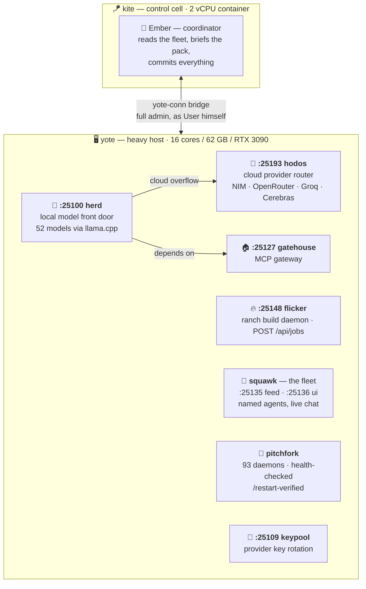

[](https://github.com/toxicwind/estate/stargazers)
[](https://github.com/toxicwind/estate/commits/main)
[](LICENSE)
[](https://github.com/toxicwind/estate)

<div align="center">

# 🏰 estate

**One human's entire compute estate — a swarm of distributed boxes, 93 supervised daemons.**

_The control plane for a one-person AI lab: local + cloud model routing, a fleet of named agents that actually talk to each other, and every daemon health-checked under one supervisor._

<p align="center">
  <a href="docs/">Explore the docs »</a>
  ·
  <a href="https://github.com/toxicwind/ranch">ranch monorepo »</a>
  ·
  <a href="https://github.com/toxicwind/estate/issues/new?labels=bug">Report Bug</a>
  ·
  <a href="https://github.com/toxicwind/estate/issues/new?labels=enhancement">Request Feature</a>
</p>

</div>

## ⚡ The estate, in one picture



## 🔍 Tour it live — 5 commands

Every command below was run against the live estate while writing this README. Paste them on any box that can reach yote:

```bash
# 1. Ask the local router what models are awake right now
curl -s http://127.0.0.1:25100/v1/models | head -c 300

# 2. Check the hodos cloud router's health
curl -s http://127.0.0.1:25193/health

# 3. See the agent fleet's live squawk chat feed (supersedes legacy estate-chat)
curl -s http://127.0.0.1:25135/health

# 4. Check the oracle decision corral (prediction-market consensus loop)
curl -s http://127.0.0.1:25151/health

# 5. Check the flicker build daemon (ranch build jobs)
curl -s http://127.0.0.1:25148/api/jobs -X POST -d '{}' | head -c 200
```

<details>
<summary><b>Table of Contents</b></summary>

1. [About](#-about)
2. [The swarm topology](#-the-swarm-topology)
3. [Repo topology](#-repo-topology)
4. [Service map](#-service-map)
5. [The ranch](#-the-ranch)
6. [The pack](#-the-pack--named-agents)
7. [Operations](#-operations)
8. [Getting started](#-getting-started)
9. [Roadmap](#-roadmap)
10. [Contributing](#-contributing)
11. [License & Security](#-license--security)
12. [Contact & Acknowledgments](#-contact--acknowledgments)

</details>

## 🏔️ About

**estate** is User's personal infrastructure monorepo — the whole laboratory, not a demo of one. It answers a single question: _what does it take for one human to run a serious AI operation across an interconnected swarm of machines?_

The answer, as committed here:

- **A model-routing layer** that treats local and cloud inference as one fabric. `herd` (:25100) fronts the on-box GGUFs through llama.cpp engines — 52 models served; anything it can't serve overflows to `hodos` (:25193), a Rust proxy that routes across cloud providers with key pools, 429 rotation, circuit breakers, and health/Elo scoring. herd currently serves 52 models on-box. The legacy `estate-router-ts` (:25104) was retired — nothing listens there anymore.
- **A fleet, not a script.** [squawk](https://github.com/toxicwind/ranch/tree/main/squawk) is a real multi-agent chat plane — signed, sequenced message files over a websocket (:25147) and feed (:25135). Named agents with actual personas join it, argue, bid on work, and narrate what they're doing. The fleet channel is the live operations log.
- **A decision engine.** The oracle runs prediction-market work loops: biddable tasks, evidence-backed yes/no verdicts, a tamper-evident ledger. When a call needs User's authority and he's not around, the oracle's verdict _is_ his approval.
- **Supervision as a first-class citizen.** 86 daemons live in `pitchfork.toml`, each health-checked, each restartable through its owning project's manifest. "Works until restart" is not a fix here — every fix lands in real files, in the owning repo, and survives a full restart.
- **The ranch.** All project work lives in the sibling monorepo [`toxicwind/ranch`](https://github.com/toxicwind/ranch) (gitignored here, own repo, own history). The estate is the control plane; the ranch is the workshop.

### Built with

Go · Rust · Python · TypeScript (Bun) · llama.cpp · pitchfork · NATS · Qdrant — and a standing rule that the fastest correct path wins.

## 🐝 The swarm topology

The estate runs across an interconnected swarm of compute nodes, edge workers, and dedicated iron coordinated over Tailscale and NATS/Funnel:

| Node / Tier                      | Hardware / Profile                                      | Role & Services                                                                                                                                                                                                              |
| -------------------------------- | ------------------------------------------------------- | ---------------------------------------------------------------------------------------------------------------------------------------------------------------------------------------------------------------------------- |
| 🖥️ **yote** (`awrawr-pc`)        | 16 cores (Ryzen 7 8700F) / 62 GiB DDR5 / RTX 3090 24 GB | **Heavy Core**: Local LLM herd (llama.cpp on :25100 — 52 models served), gatehouse MCP (:25127), keypool (:25109), flicker build daemon (:25148), and persistent state.                                                      |
| 🪁 **kite** (dodge name: hatch)  | 2-vCPU cell container on 126-core EPYC host             | **Control Cell**: High-velocity agent coordination, Ember dispatch, and fleet briefs over the `yote-conn` bridge. Live checkout `/home/toxic/kite/kite`; CLI at [toxicwind/kite-cli](https://github.com/toxicwind/kite-cli). |
| 🌐 **Dedicated Servers (dedis)** | Heterogeneous remote Linux iron                         | High-throughput distributed task execution, automated CI/CD runners, and background scraper workloads.                                                                                                                       |
| 📱 **Edge & Fleet Nodes**        | Pixel 9 Pro XL (ADB/Termux), Android fleet              | Sensor endpoints, mobile testing harness, and localized satellite runners.                                                                                                                                                   |

The rule is absolute: **heavy work belongs on yote and dedicated worker nodes, never on lightweight coordination cells.** Keep coordination snappy and fan out compute to iron.

## 🗂️ Repo topology — three repos, one estate

The estate's work is split across three GitHub repos. All three `main` SHAs below were verified live on 2026-10-15 (`git ls-remote`).

| Repo                                                    | Visibility | `main` (verified) | What it is                                                                                                                                                                                                      |
| ------------------------------------------------------- | ---------- | ----------------- | --------------------------------------------------------------------------------------------------------------------------------------------------------------------------------------------------------------- |
| [toxicwind/estate](https://github.com/toxicwind/estate) | PUBLIC     | `afc857114`       | This repo — the control plane.                                                                                                                                                                                  |
| [toxicwind/ranch](https://github.com/toxicwind/ranch)   | PUBLIC     | `78bbc8ede`       | The workshop — nested in the checkout at `ranch/` (gitignored here, own repo, own history).                                                                                                                     |
| [toxicwind/hatch](https://github.com/toxicwind/hatch)   | PRIVATE    | `69bb4b0b6`       | The control-cell repo — split out of this repo's former `hatch/` tree with full history (see below). Checked out live at `/home/toxic/hatch` on yote; tracked/referenced by the estate but no longer inside it. |

**The kite/hatch split.** The control cell's real identity is **kite**; `hatch` is the dodge name the outside sees. The control-cell tree — real identity **kite**, dodge name **hatch** — was split out into `toxicwind/hatch` with full history ([final split `d050f680`](https://github.com/toxicwind/hatch/commit/d050f680c51f8da9949f73161a11c6ed626883c7) — 171 commits, 593 files: agents, bin, cell-files, crons, docs, pollers, task-launch, the sidechat shim, …). The hatch repo is PRIVATE: control-cell internals stay behind the fence. On 2026-10-02 (User's direct order) `hatch/` removal was ordered; completed 2026-10-15 (the last 258 stale in-tree files removed, backup branch `backup/hatch-tree-20261015`; live checkout `/home/toxic/kite/kite`) — the live checkout is `/home/toxic/hatch` on yote, and the estate references it (reshim cron, pollers, docs) without containing it.

**Q1 resolved — `hatch/` removed.** On 2026-10-02 User ordered the move completed: `hatch/` was removed from the estate tree in commit [`4bd380beab`](https://github.com/toxicwind/estate/commit/4bd380beab01db1c0cda054a3f2ac75fa18acd9d) ("Remove hatch/ — moved to toxicwind/hatch (PRIVATE)"). No submodule, no in-tree copy — the estate references `toxicwind/hatch` (live at `/home/toxic/hatch` on yote) and does not contain it.

### Top-level repo map

What lives where in this repo, at the top level (all verified present 2026-10-15):

| Path               | Role                                                                                                            |
| ------------------ | --------------------------------------------------------------------------------------------------------------- |
| `ranch/`           | Nested project monorepo ([toxicwind/ranch](https://github.com/toxicwind/ranch)) — gitignored here, own history. |
| `bin/`             | Estate-wide operational scripts (`estate-reconcile`, `estate-scan`, `audit-estate.sh`, …).                      |
| `docs/`            | Estate docs — start with [`docs/ARCHITECTURE.md`](docs/ARCHITECTURE.md).                                        |
| `pitchfork.toml`   | Composed daemon inventory (93 daemons) — generated, edit the project manifests.                                 |
| `pitchfork.d/`     | Per-project daemon manifests — the source of `pitchfork.toml`.                                                  |
| `config/ports.env` | Port SSOT.                                                                                                      |
| `stack/`           | Service launch scripts (`stack/services/herd.sh`, …).                                                           |
| `engines/`         | llama.cpp engine checkouts backing herd.                                                                        |

## 🗺️ Service map

Every row below was verified against the live box on 2026-10-15 (port probed + listener checked via `ss`). This table is the contract — if a row lies, that's a bug, file it.

| Service                     | Port                | What it is                                                                                                                                                                                            |
| --------------------------- | ------------------- | ----------------------------------------------------------------------------------------------------------------------------------------------------------------------------------------------------- |
| 🚂 **herd**                 | `25100`             | Local model front door. `/v1/models` serves the on-box GGUF catalog (llama-swap engines on `:25001+`); cloud traffic overflows to hodos. Launched via `stack/services/herd.sh`, depends on gatehouse. |
| 🦅 **hodos**                | `25193`             | External provider router (Rust). Strategies, key pools, 429 rotation, circuit breakers, health/Elo. Auth-gated — bring a `Bearer` key.                                                                |
| 🧭 ~~**estate-router-ts**~~ | ~~`25104`~~         | **RETIRED** — no listener, no daemon definition (verified 2026-10-15). The fleet default moved to `estate/free` via hodos/herd.                                                                       |
| 🏠 **gatehouse**            | `25127`             | MCP gateway — tool serving, a peer of the routers, not their parent. Has a `/ui/`.                                                                                                                    |
| 📱 ~~**phone-sentinel**~~   | ~~`25178`~~         | **DOWN** — no listener (verified 2026-10-15).                                                                                                                                                         |
| 🔑 **keypool**              | `25109`             | Provider key pool sidecar. `/health` → `{"ok":true,"service":"keypool"}`.                                                                                                                             |
| 🛡️ **model-guard**          | `25101`             | Inference safety layer. _(Fleet note 2026-10-02: was serving its upstream-unreachable fallback when this table was written — tracked as a live issue, not doc drift.)_                                |
| 💬 ~~**squawk-ws**~~        | ~~`25147`~~         | **DOWN** — no listener (verified 2026-10-15); the feed (:25135) and UI (:25136) carry the channel.                                                                                                    |
| 📜 **squawk feed**          | `25135`             | Fleet message feed API — the live channel plane (`squawk-ws` :25147 is down as of 2026-10-15).                                                                                                        |
| 🏗️ ~~**nativelink**~~       | ~~`25155`/`25157`~~ | **DOWN** — no listener on either port (verified 2026-10-15).                                                                                                                                          |
| 🔥 **flicker**              | `25148`             | Ranch build daemon (`POST /api/jobs`). Direct binary, no container runtime. (Formerly mislabeled "mbx-cache".)                                                                                        |
| 🔮 **oracle**               | `25151`             | Standalone decision corral — prediction-market work loop, biddable tasks, dated yes/no verdicts on evidence, tamper-evident ledger.                                                                   |
| 🖥️ **fleet-ui**             | `25136`             | Fleet web UI, reachable over the tailnet (serves at `/`).                                                                                                                                             |
| 📊 **Ralph dashboard**      | `25194`             | Ops dashboard (HTML UI).                                                                                                                                                                              |
| 🧠 **codebase-memory**      | `25195`             | Codebase graph UI (serves at `/`).                                                                                                                                                                    |

Full daemon inventory (93, with health checks and restart paths): [`pitchfork.toml`](pitchfork.toml) — port SSOT is `config/ports.env`.

## 🏕️ The ranch

All project work lives in the ranch — the sibling monorepo at [toxicwind/ranch](https://github.com/toxicwind/ranch):

> `ranch/` is gitignored in this repo (_"project monorepo — own git repo"_). It has its own history, its own README with a 36-component table (every path and port audited 2026-10-02), and its own release rhythm. The estate holds the control plane (supervision, routing, fleet); the ranch holds the projects (agents, routers, tools, benchmarks).

Start there if you want to see what the estate _builds_. Start here if you want to see how it's _run_.

## 🐾 The pack — named agents

The fleet is not a metaphor. Named agents — each with a species, a personality, and a lane — join the squawk channel, post their own hellos, bid on oracle tasks, argue the point, and narrate their work live. Ember (the coordinator) briefs them; they speak for themselves — nobody writes an agent's words for it.

A few of the crew: **Forge** (migration smith) · **Nightjar** (night-lanes coordinator) · **Sable** (docs) · **Vesper** (evening shepherd) · **Cinder** (subagent control) · **Tally** (verifier) · **Lumen** (squawk UI) · **Warden** (drift-watch). The roster changes — the fleet channel is the source of truth.

## 🔧 Operations

**pitchfork** is the daemon supervisor. The composed `pitchfork.toml` at the repo root is generated from per-project manifests (`<project>/pitchfork.d/<daemon>.toml`) — edit the project source, never the composed file. The hard-won rule, learned from a 12-hour stale-definition incident:

> pitchfork does **not** hot-reload. After any daemon edit, re-register and restart through the owning project's path, then verify `/health`. A daemon can report `errored` in pitchfork while its orphaned predecessor still answers 200 — trust the re-registration, not the dashboard.

Key operational scripts live in `bin/` (`estate-reconcile`, `estate-scan`, `audit-estate.sh`, …). Estate-wide docs live in `docs/` — start with [`docs/ARCHITECTURE.md`](docs/ARCHITECTURE.md).

## 🚀 Getting started

**Prerequisites:** this repo runs User's estate — it is personal infrastructure, not a library. You don't `pip install` it; you _tour_ it. To run the tour you need network reachability to yote (the tailnet) and nothing else.

**The 30-second tour** (same five commands as above — they are the quickstart):

```bash
# 1. What models are awake?
curl -s http://127.0.0.1:25100/v1/models | python3 -c "import json,sys; [print(m['id']) for m in json.load(sys.stdin)['data'][:5]]"

# 2. Is the hodos cloud router healthy?
curl -s http://127.0.0.1:25193/health | head -c 200; echo

```

# 3. Is the squawk pack feed active?

curl -s http://127.0.0.1:25135/health

# 4. Is NativeLink serving the build cache?

curl -s http://127.0.0.1:25155/status

**Go deeper:** [`docs/`](docs/) holds the architecture contracts — start with
[`docs/REPO_TOPOLOGY.md`](docs/REPO_TOPOLOGY.md) (the canonical estate/ranch/GitHub
model), [`docs/CONVENTIONS.md`](docs/CONVENTIONS.md) (git rules), and
[`docs/estate-map.md`](docs/estate-map.md) (generated service map). `ranch/`
(sibling repo) holds the projects; the [ranch README](https://github.com/toxicwind/ranch#readme)
maps all 36 components.

## 🗺️ Roadmap

- [x] Estate repo public, ranch public, hatch private — visibility policy set 2026-10-02
- [x] hatch split — `hatch/` split out to [toxicwind/hatch](https://github.com/toxicwind/hatch) (final split `d050f680`, 171 commits, 593 files)
- [x] 93 daemons under pitchfork supervision with health checks
- [x] herd/hodos two-layer model routing, live (legacy estate-router :25104 retired)
- [x] **Legacy router retirement**: `:25104` (estate-router-ts) retired — nothing listens, no daemon definition (verified 2026-10-15)
- [ ] **Squawk-ws revival or removal**: :25147 has no listener — either revive the websocket lane or drop it from the surface
- [ ] **Oracle proof**: real dated yes/no verdict before autonomy leans on it
- [ ] **Per-lane pollers**: one cheap heartbeat poller per agent lane
- [x] **hatch Q1 resolved** — `hatch/` removed from the estate tree (estate `4bd380beab`, 2026-10-02, User's direct order); repo lives at [toxicwind/hatch](https://github.com/toxicwind/hatch), live checkout `/home/toxic/kite/kite` on yote — the dodge name `hatch` is what the outside sees; the real cell is kite

## 🤝 Contributing

This is personal infrastructure with a public window — the interesting parts accept company. Read [`CONTRIBUTING.md`](CONTRIBUTING.md), then open an issue before a PR so the direction gets a yes first. The standing rules: maximal autonomous execution, every fix in real files in the owning repo, nothing that only works until restart, and the fleet narrates everything.

## 📄 License & Security

Distributed under the **MIT License** — see [LICENSE](LICENSE) for details.

Security policy and reporting: [`.github/SECURITY.md`](.github/SECURITY.md). Note this repo's threat model is a personal lab, not a SaaS — the security doc says what that means in practice.

## 📬 Contact & Acknowledgments

Maintainer: **User** ([@toxicwind](https://github.com/toxicwind)) — the human the whole estate serves.

Acknowledgments: the herd/hodos/tau lineage builds on outstanding open-source work (llama.cpp, the Bun and Rust ecosystems, and the many provider APIs the routers perch on); the fleet's culture owes a debt to every agent that ever posted a hello in its own voice. Full third-party notices: [`THIRD-PARTY-NOTICES.txt`](THIRD-PARTY-NOTICES.txt).

---

<div align="center">

**If the estate made you think — give it a star. ⭐**

_The pack notices. Really._

</div>
