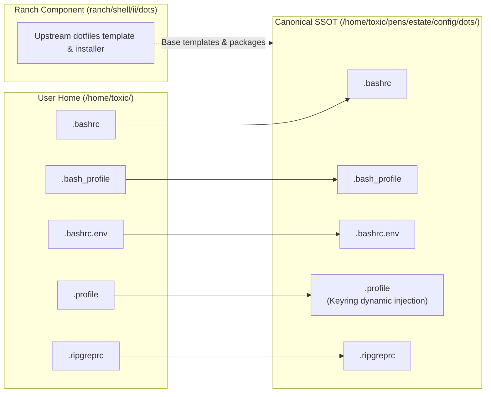

# 🐚 Estate Canonical Dotfiles (`estate/config/dots`)

The single source of truth (SSOT) for the workstation's core shell environment and dotfiles, managed directly by `estate` and integrated with `ranch/shell` (`ii/dots`).

---

## 🗺️ Architecture & Link Map

Instead of disparate, floating files in `$HOME`, every primary dotfile is tracked here under version control and symlinked directly into `/home/toxic/`:



| File | Link Path in `$HOME` | Purpose |
|---|---|---|
| `.bashrc` | `~/.bashrc` | Main interactive bash configuration (aliases, functions, path hooks, fzf integration). |
| `.bash_profile` | `~/.bash_profile` | Login shell entrypoint (sources `~/.bashrc`). |
| `.bashrc.env` | `~/.bashrc.env` | Environment variables, tool paths (`/home/toxic/.local/bin`, `cargo`, `bun`, `go`). |
| `.profile` | `~/.profile` | System profile startup (exports session defaults; dynamic `secretsmith` token resolution). |
| `.ripgreprc` | `~/.ripgreprc` | Ripgrep defaults (`--smart-case`, hidden-file settings). |

---

## 🔗 Connection to `ranch/shell`

- **Upstream Root**: `/home/toxic/pens/estate/ranch/shell/`
- **Installer & Packaging**: `ranch/shell/ii/` maintains dotbot installers (`install.conf.yaml`), Arch package definitions (`packages.arch.txt`), and machine provisioning setups.
- **Dynamic Secrets Management**:
  Per **Rule 3** of the estate doctrine, secrets (e.g. `GITHUB_TOKEN`) are never hardcoded in dotfiles. They are dynamically resolved via `secretsmith get ...` upon shell entry.

---

## 🧪 Verification & Health Check

To test syntax validity across all managed dotfiles:
```bash
bash -n /home/toxic/pens/estate/config/dots/.bashrc
bash -n /home/toxic/pens/estate/config/dots/.bash_profile
bash -n /home/toxic/pens/estate/config/dots/.profile
```
All files must return clean with `0` exit codes.
