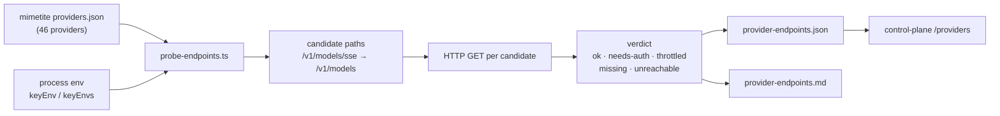

# provider-endpoints

**The live truth about every provider's models endpoint — probed, not
guessed.**

[](provider-endpoints.json)
[](provider-endpoints.json)
[](provider-endpoints.json)
[](probe-endpoints.ts)
[](../../ranch/mimetite)

---

## Why should you care?

The provider catalog says _where_ a provider lives. It does not say whether
that endpoint **answers**, which path holds the model list, or which models
are actually behind it. Guessing produced a control plane that reported
"available" for providers whose `/v1/models` returned `404`, and "unavailable"
for providers that were serving a hundred models happily.

This probe settles it:

- **Prefers `/v1/models/sse`** and falls back to `/v1/models` (the
  OpenAI-compatible model list), with per-provider path overrides where the
  list does not live under `/v1`.
- **Records what actually happened** — `ok`, `needs-auth`, `throttled`,
  `missing`, `unreachable`. Nothing is inferred from the catalog.
- **Counts the models** and flags the Qwen models each provider exposes.
- **Never prints a secret**: only the env var _name_ that authenticated the
  request appears in the artifact.

## Quick start

```bash
cd /home/toxic/estate && bun ops/provider-endpoints/probe-endpoints.ts
```

Writes `provider-endpoints.json` (machine-readable) and
`provider-endpoints.md` (human table) next to this file.

## Architecture



### Path overrides

| Provider         | Model-list path                                            | Why                                                                                            |
| ---------------- | ---------------------------------------------------------- | ---------------------------------------------------------------------------------------------- |
| `chutes`         | `/v1/chutes/models`                                        | Chutes does not expose an OpenAI-style `/v1/models`; the OpenAI-compatible root answers `404`. |
| `bedrock-mantle` | `https://bedrock-mantle.<region>.api.aws/openai/v1/models` | the catalog stores a `{region}` template that must be resolved before probing.                 |
| `qianfan`        | `/v2/models`                                               | Baidu's Qianfan is a v2 API; the v1-style path does not exist.                                 |

## What the last run found

| Signal                  | Count | Detail                                                                                                     |
| ----------------------- | ----- | ---------------------------------------------------------------------------------------------------------- |
| `ok`                    | 24    | the model list answered with entries                                                                       |
| `needs-auth`            | 17    | endpoint exists (`401`/`403`), no key on the box                                                           |
| `throttled`             | 1     | `chutes` — nginx `429` from the box's egress IP                                                            |
| `missing`               | 4     | `bedrock-mantle`, `github`, `google` (local), `omniroute` (local)                                          |
| providers exposing Qwen | 13    | `inferbase` 41, `aimlapi` 35, `deepinfra` 27, `parasail` 24, `venice` 20, `novita` 15, `commandcode` 11, … |

Notes that cost real time to learn:

- **The model list is often public.** `aimlapi` (943 models), `deepinfra`
  (177), `venice` (136), `inferbase` (127), `minara` (126), `novita` (96),
  `commandcode` (96) and `sambanova` answer `/v1/models` **without a key** —
  so the roster can be verified even before credentials land.
- **`freeinference` is the only provider that serves Qwen for free.**
  `groq` and `cerebras` expose exactly one Qwen each, both billed.
- **Two dead secrets on the box** (both `401`, not found by the provider):
  `OPENROUTER_API_KEY_FREE` and `EXA_API_KEY`. The OpenRouter _paid_ key is
  valid but has **zero credits**, so only OpenRouter's `:free` models are
  usable from here; search tooling fell back to Brave/Tavily, which work.

## Configuration

| Variable                   | Default                                       | Purpose              |
| -------------------------- | --------------------------------------------- | -------------------- |
| `PINAX_PROVIDERS_JSON`     | `estate/ranch/mimetite/generated/providers.json` | the catalog to probe |
| `PROBE_TIMEOUT_MS` (const) | `8000`                                        | per-request deadline |
| `CONCURRENCY` (const)      | `12`                                          | parallel probes      |

## Development

- The artifact is a **snapshot**, not a source of truth: the catalog in Mimetite
  stays the SSOT for _what a provider is_; this file is the truth about
  _what it answers right now_.
- Re-run it after adding a provider to Mimetite, after a port migration, or when
  a provider starts 404-ing in the dashboard.
- Adding a provider whose model list is not under `/v1`? Add a
  `PATH_OVERRIDES` entry with the path — and say why in the comment.

## Security

- No secret values are written, logged or committed — only env var **names**.
- Probe traffic is read-only `GET`s against public model-list endpoints.
- The artifact is safe to commit to the estate repository.
