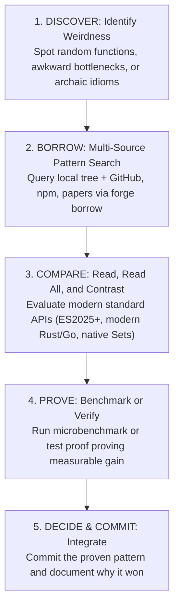

# pattern-forge

Unified estate pattern engine consolidating **`race-borrow`**, **`ast-bm25-racer`**, and **`code-racer-swe`** into a single cohesive runtime.

Doctrine: **Many readers, one writer; first valid answer wins; local tree and external art race concurrently; slow path stays hot via persistent winner ledgers.**

### Unified Subcommands

```bash
# 1. RETRIEVE: In-tree AST-BM25 hybrid symbol search across local codebase
forge retrieve --root <dir> --query "<query>" [--top N]

# 2. BORROW: Concurrent parallel race across local codebase + 7 external sources (GitHub, arXiv, OpenAlex, etc.)
forge borrow "<query>" [--per-source N] [--skip source1,source2]

# 3. RACE: Concurrent first-valid-wins strategy racing with hedging
forge race --strategies <file.json> [--hedge-ms MS] [--race-timeout S]

# 4. BENCH: Nanosecond microbenchmarks across candidate patches
forge bench [--candidates cands.json] [--warmup N] [--runs N]

# 5. AUDIT: Structural AST pattern verification via ast-grep
forge audit --root <dir> --claim "<claim>" | --pattern '<pattern>' --lang <lang>

# 6. SUBGRAPH: Call graph induction from stack trace frames
forge subgraph --root <dir> --trace <error.log> [--depth N]

# 7. MCTS: Monte Carlo Tree Search candidate selection
forge mcts (--candidates "a,b,c" | --candidates-file c.json) [--depth N] [--timeout S] [--real]
```

---

## 🔄 The Complete Pattern-Forge Workflow: Discover -> Borrow -> Compare -> Prove -> Decide

Pattern-forge is not merely a search tool; it is a **continuous code evolution engine**. Do not just borrow and blindly copy code. Use the complete 5-step lifecycle:



### 1. Step 1: DISCOVER Weirdness
Pick random functions, bottlenecks, or odd constructs in active code:
- Complex hand-rolled math/set algorithms (e.g., custom array intersection instead of modern Set methods).
- Arbitrary string sorting (`sort((a,b) => a.localeCompare(b))` without numeric/sensitivity flags).
- Excessive synchronous I/O or quadratic $O(N^2)$ loops.
- Obsolete wrappers or missing modern language idioms.

### 2. Step 2: BORROW Pattern Art
Use `forge borrow` to race across external repositories, npm packages, and research papers:
```bash
forge borrow "<exact function or concept>"
# Example:
forge borrow "localeCompare(b.path)"
forge borrow "jaccard similarity set intersection union typescript"
```

### 3. Step 3: COMPARE & CONTRAST
- **Read All Results**: Don't just grab the first snippet. Inspect how modern reference projects structure the same solution.
- **Identify Standard Advancements**:
  - Does the language or runtime now offer native zero-allocation primitives (e.g. `Set.prototype.intersection`, `Set.prototype.union`)?
  - Are there options flags that resolve edge-case bugs (e.g. `{ numeric: true, sensitivity: 'base' }`)?
  - Are disk-backed caches appropriate (e.g. `sync-disk-cache` patterns)?

### 4. Step 4: PROVE the Improvement
Never merge an "assumed" improvement without an executable proof:
- Run micro-benchmarks via `forge bench` or throwaway timing scripts.
- Prove performance (e.g. $O(N)$ vs $O(N^2)$), memory reduction (zero intermediate array allocations), or bug avoidance.
- Verify that all existing unit tests still pass.

### 5. Step 5: DECIDE & COMMIT
If and only if the proof demonstrates clear value:
- Replace the legacy construct with the modern pattern.
- Document the winning pattern in the commit log or code comment.

---

## Leg 1 — retrieve

In-tree hybrid retrieval across the local ranch / estate:

```bash
forge retrieve --root /home/toxic/estate/ranch --query "agent memory eviction"
```

- Scans TypeScript, JavaScript, Python, Go, Rust, and Markdown.
- Tokenizes symbols using Bun's native scanner.
- Scores candidates via BM25 + AST node centrality.

## Leg 2 — borrow

Pulls prior art from GitHub code, arXiv papers, OpenAlex research citations, and npm packages concurrently.

```bash
forge borrow "session compaction capillary limit" --per-source 5
```

- Fast failover across degraded network providers.
- Output presents source citations, relevance confidence, and code snippets.

## Leg 3 — race

Races competing strategies with automatic hedging:

```bash
forge race --strategies strategies.json --hedge-ms 50
```

## Leg 4 — bench

Microbenchmarks competing implementations:

```bash
forge bench --candidates cands.json --runs 100
```

## Leg 5 — mcts

Chooses optimal patches via Monte Carlo rollouts:

```bash
forge mcts --candidates "bun test","cargo test" --real --timeout 120
```

## Leg 6 — subgraph

Induces dependency subgraphs from runtime tracebacks:

```bash
forge subgraph --root /home/toxic/estate/ranch/tau --trace tb.txt --depth 3
```

## Leg 7 — audit

Audits code claims against structural AST rules via `ast-grep`:

```bash
forge audit --root /home/toxic/estate/tools/estate-router \
  --claim "estate router listens on port 25104"
```
